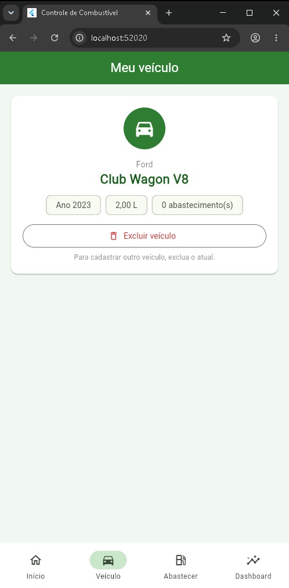
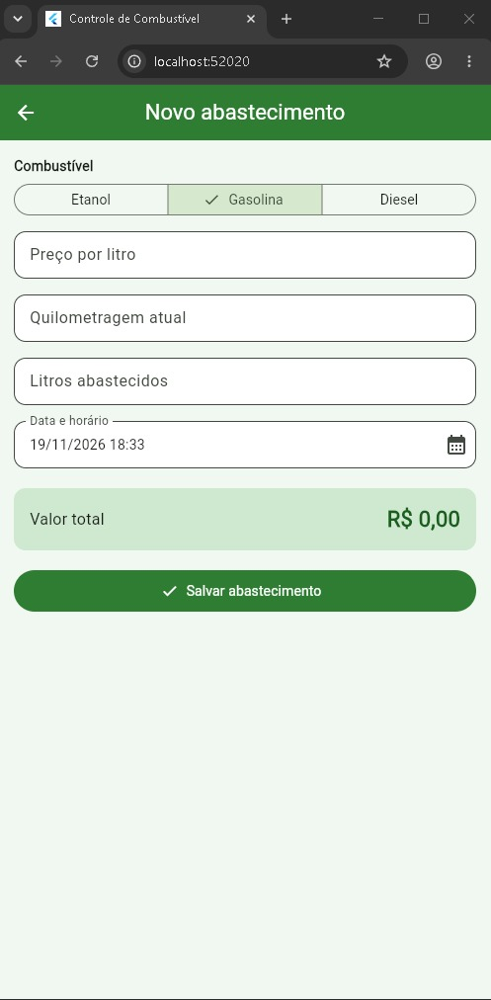
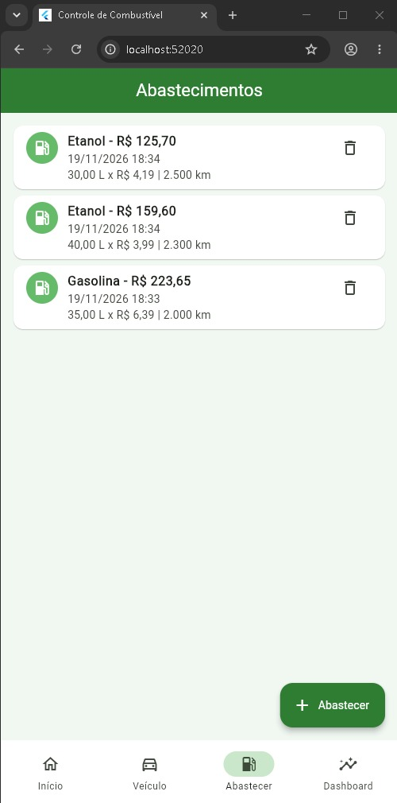
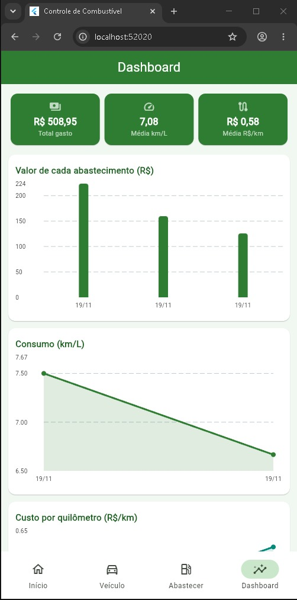
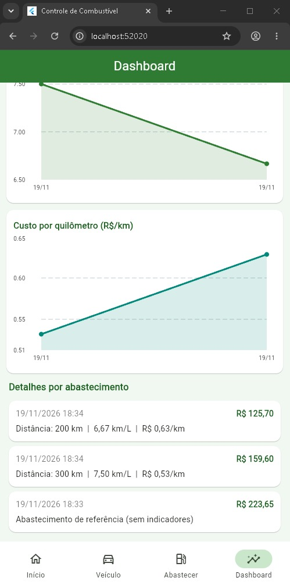
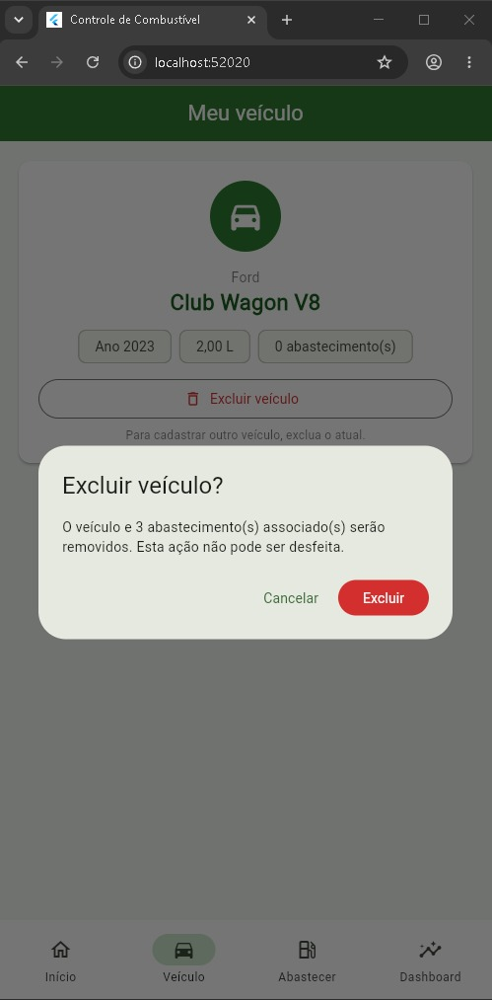

# Controle de Combustível

Aplicativo Flutter para registrar abastecimentos de um veículo e acompanhar gastos e consumo ao longo do tempo.
Atividade Substitutiva da Prova 1 — Programação para Dispositivos Móveis I (Prof. Arley).

## Funcionalidades

- **Veículo:** cadastro de um único veículo (marca, modelo, ano e cilindrada). Marca e modelo vêm da API pública; o modelo depende da marca escolhida. Para trocar de veículo, é preciso excluir o atual (com confirmação), o que também apaga os abastecimentos dele.
- **Abastecimentos:** combustível (etanol, gasolina ou diesel), preço por litro, quilometragem, litros e data/hora. O valor total (preço × litros) é calculado automaticamente.
- **Persistência local:** veículo e abastecimentos continuam salvos depois de fechar o app.
- **Dashboard:** valor de cada abastecimento, consumo (km/L) e custo por km (R$/km) em gráficos.
  - Distância = km atual − km do abastecimento anterior
  - km/L = distância ÷ litros do abastecimento atual
  - R$/km = valor total do abastecimento atual ÷ distância
  - O primeiro abastecimento é só referência (sem km/L e R$/km).

## Como executar

Requisitos: [Flutter SDK](https://docs.flutter.dev/get-started/install) 3.22 ou superior.

```bash
git clone <link-do-repositorio>
cd controle_combustivel
flutter create .        # gera as pastas android/ios (só na primeira vez)
flutter pub get
flutter run
```

> **Android:** confirme que `android/app/src/main/AndroidManifest.xml` tem, antes da tag `<application>`:
> `<uses-permission android:name="android.permission.INTERNET"/>`

## API e bibliotecas

| Item | Uso |
|------|-----|
| [BrasilAPI — FIPE](https://brasilapi.com.br/docs#tag/FIPE) | Marcas (`/api/fipe/marcas/v1/carros`) e modelos (`/api/fipe/veiculos/v1/carros/{codigoMarca}`) |
| `http` | Requisições à API |
| `shared_preferences` | Persistência local (JSON) |
| `fl_chart` | Gráficos de barras e linhas |
| `intl` / `flutter_localizations` | Formatação em pt-BR (moeda, datas) |

## Estrutura

```
lib/
├── main.dart            # inicialização, tema e localização
├── theme.dart           # paleta verde
├── models.dart          # Vehicle, Refuel e cálculo dos indicadores
├── api.dart             # consumo da BrasilAPI
├── app_state.dart       # estado + persistência
├── format.dart          # formatação e parse de números
└── screens/             # home (navegação), início, veículo, abastecimentos, formulário e dashboard
```

## Capturas de tela

| Veículo cadastrado | Novo abastecimento | Lista de abastecimentos |
|:---:|:---:|:---:|
|  |  |  |

| Dashboard (resumo e valores) | Dashboard (km/L e R$/km) | Confirmação de exclusão |
|:---:|:---:|:---:|
|  |  |  |
